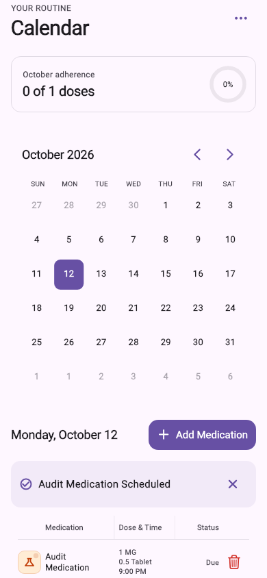

# Scheduler input, reminders, and data consistency

Validated on October 10, 2026.

## Problems and fixes

The time picker inserted validation messages as new list siblings above the
input card. Clearing or temporarily invalidating an hour/minute replaced the
editable subtree, detached its keyboard connection, and lost focus. Validation
now changes inside a stable slot. Invalid drafts show “Enter a time” and cannot
be confirmed. The web notification overlay also keeps its wrapper mounted when
a toast appears or expires, preserving search text, focus, and page state.

Native reminders previously created an alert for each simultaneous dose and
requeued unchanged future requests on every sync. Reminders at the same instant
now share one OS request and preserve all dose IDs. Foreground bursts use one
summary alert. Unchanged requests stay scheduled. Cancelling one member of a
batch preserves its neighbors and their original time, including after a
service restart. Delayed requests are never rescheduled in the past.

The notification service uses the same occurrence identity and status precedence
as the UI, including legacy `HH:mm` and canonical `HH:mm:ss` records. Taken or
cancelled duplicates cannot create a due alert. Receipts suppress repeat alerts
when a record ID changes or the service restarts; a receipt for an earlier time
does not suppress a snoozed reminder. iOS delivered alerts retain their
receipts in their notification payloads.

The calendar's pending rows showed the selected dose amount, but the hydrated
rows lost it. Pending and persisted calendar rows now show the same medication
name, strength, dose amount/unit, and time; the dashboard includes the saved dose
amount too. Table details use separate lines and can grow to show the complete
time. Confirmed scheduler drafts retain the same local date, `HH:mm:ss` time,
amount, frequency, and IANA timezone in schedule/dose writes. Clock times skipped
by daylight saving are rejected instead of silently saving another time.
Timezone data is initialized once for time-picker validation.

## Verification

- Full Flutter suite: **500 passed**.
- Chrome regression suite: **66 passed** across time entry, auth/profile/search,
  scheduler persistence, toast lifecycle, reminders, and calendar/dashboard rows.
- `flutter analyze --no-pub`: no issues.
- Release web build and debug iOS simulator build: passed.
- Character-by-character tests keep one keyboard connection while clearing,
  deleting, correcting invalid input, and crossing past/future time validation.
- iOS form variants cover 390 × 844 and 1280 × 800 layouts, keyboard
  insets, and parent rebuilds. Time-entry tests also cover 12/24-hour formats,
  larger desktop sizes, and large text.
- Scheduler tests compare displayed drafts to captured write values and then
  hydrate the same records to verify unchanged IDs, labels, dates, and status.
- Native method-channel tests cover iOS, eight simultaneous
  doses, reordered snapshots, cancellation, native delivery versus foreground
  catch-up, the iOS 64-request limit, restart receipts, snoozing, and legacy data.

The original continuous-typing tests failed on the unmodified time picker
because the `EditableTextState` was disposed after clearing a field. They pass
after the fix. Other existing camera, scanner, scheduling, and account regressions
remain in the full suite.



The image is a rendered 390 × 844 widget test with readable Roboto/icon fonts and
synthetic medication data. It shows strength, the stored 0.5-tablet amount, and
the full 9:00 PM reminder time.

## Reproduction commands

```sh
flutter analyze --no-pub
flutter test --no-pub
flutter test --no-pub --platform chrome \
  test/schedule_time_selection_test.dart \
  test/text_input_focus_regression_test.dart \
  test/dose_amount_regression_test.dart \
  test/notification_shell_regression_test.dart \
  test/medication_notification_service_test.dart \
  test/calendar_table_layout_test.dart \
  test/dashboard_table_layout_test.dart
flutter build web --no-pub
flutter build ios --simulator --debug --no-codesign --no-pub
```

Native notification behavior was verified through realistic platform-channel
mocks and native compilation. Physical-device delivery, device notification
settings, and every mobile browser/keyboard were not exercised in this run.
Different scheduled instants remain separate reminders; simultaneous doses and
duplicate occurrences do not create a burst of individual alerts.
